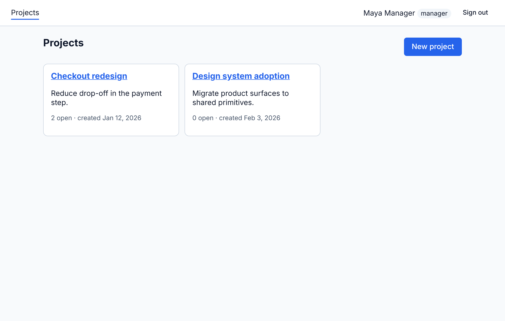
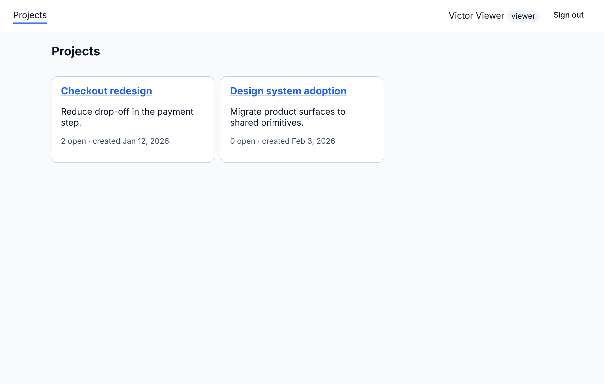

# enterprise-react-app

[](https://github.com/smrafi4130/enterprise-react-app/actions/workflows/ci.yml)

A feature-based React 18 + TypeScript reference application: an internal project/issue tracker with role-based access, server-state synchronisation, a typed API layer and three test layers.
It consumes the [`@smrafi/ui`](https://github.com/smrafi4130/react-design-system) design system.

| Sign in                              | Manager                                           | Viewer                                          |
| ------------------------------------ | ------------------------------------------------- | ----------------------------------------------- |
|  |  |  |

## Problem

Admin-style apps tend to collapse into one big folder where auth checks, fetching and UI are tangled. This repo is a worked example of keeping them separable: boundaries enforced by tooling, authorization expressed as permissions, and behaviour verified against a realistic API contract.

## Architecture

```
src/
  app/        composition root: providers, router, layout, wiring (may import features)
  features/   auth · projects · issues · users   (each exposes only index.ts)
  shared/     api client, errors, permissions, observability, generic UI (knows no domain)
  mocks/      MSW handlers + in-memory DB (dev, tests, E2E)
```

Dependencies point one way: `app → features → shared`. ESLint fails the build on deep imports into a feature or on features importing `app/`.

Key mechanisms:

- **API client** (`shared/api/client.ts`): bearer auth, Zod-validated responses (`ContractError` on drift), typed `ApiError`/`NetworkError`, single-flight token refresh on 401 with one retry.
- **Authorization** (`shared/lib/permissions.ts`): UI asks `can(role, "issue:update")`, never `role === "admin"`. Used by route guards (`RequirePermission`), `<Can>` and `useCan`. The UI hides controls; the server must still enforce (the mock does, returning 403).
- **Server state**: TanStack Query with co-located query keys, optimistic issue-status updates with rollback, retries only for retryable errors.
- **Resilience**: route-level `ErrorBoundary`, retryable `ErrorState`, pluggable error reporter (`setErrorReporter`) as the Sentry/Datadog seam.
- **Performance**: `Issues` and `Users` routes are lazy; vendor chunks split manually.

Decisions are recorded in [`docs/adr`](docs/adr): feature structure, server state, token storage, MSW boundary.

## Getting started

```bash
pnpm install
pnpm dev                 # http://localhost:5173 (API served by MSW in the browser)
pnpm lint && pnpm typecheck && pnpm test && pnpm build
pnpm e2e                 # builds, serves the production bundle, runs Playwright
```

Demo accounts, password `password`: `admin@example.com`, `manager@example.com`, `viewer@example.com`.

## Testing

| Layer       | Tooling                                | What it proves                                                                                                                                                               |
| ----------- | -------------------------------------- | ---------------------------------------------------------------------------------------------------------------------------------------------------------------------------- |
| Unit        | Vitest                                 | permission matrix (roles strictly nested), API client: auth header, schema validation, 401 refresh, single-flight, no refresh loops                                          |
| Integration | Vitest + Testing Library + MSW         | login redirect/return, bad credentials, silent token refresh, RBAC per role, route guard, project creation + validation, optimistic update + rollback, retryable error state |
| E2E         | Playwright on the **production build** | viewer read-only, manager create/update flow, session survives reload, skip link and dialog focus return                                                                     |

Last local run: 26 unit/integration tests and 4 E2E tests passing; statement coverage 96%, branch coverage 90%.

## Bundle (production, gzip)

| Chunk                                               | Size            |
| --------------------------------------------------- | --------------- |
| app                                                 | 20.5 kB         |
| react + router                                      | 67.3 kB         |
| react-query                                         | 12.7 kB         |
| issues / users routes (lazy)                        | 1.3 kB / 0.7 kB |
| MSW (`browser-*.js`, loaded only when mocks are on) | 99.7 kB         |

Production deployments pointing at a real API set `VITE_USE_MOCKS=false`, which removes MSW from the loaded path.

## Trade-offs and limitations (honest status)

- **No real backend.** The API is an in-memory MSW mock; data resets on page load. The client code is written against HTTP and does not know this, but backend concerns (persistence, real JWTs, server-side RBAC, rate limiting) are not demonstrated here.
- **Token storage** is a documented compromise (ADR-0003). The production recommendation is an httpOnly cookie.
- **Design-system dependency** is vendored as tarballs in `vendor/` because the packages are not published to npm yet; CI works with no sibling checkout. Switch to registry versions once published.
- Issue status uses a native `<select>`; there is no drag-and-drop board.
- No i18n, no pagination or virtualisation (lists are small by construction), no real-time updates.
- Accessibility is checked by component-level axe tests in the design system and keyboard E2E here; there is no automated axe pass over every page yet.

## Roadmap

Pagination + cursor queries, axe in E2E, real backend (see the full-stack project on the portfolio roadmap), Sentry reporter, route-level error boundaries per feature.

## License

MIT
